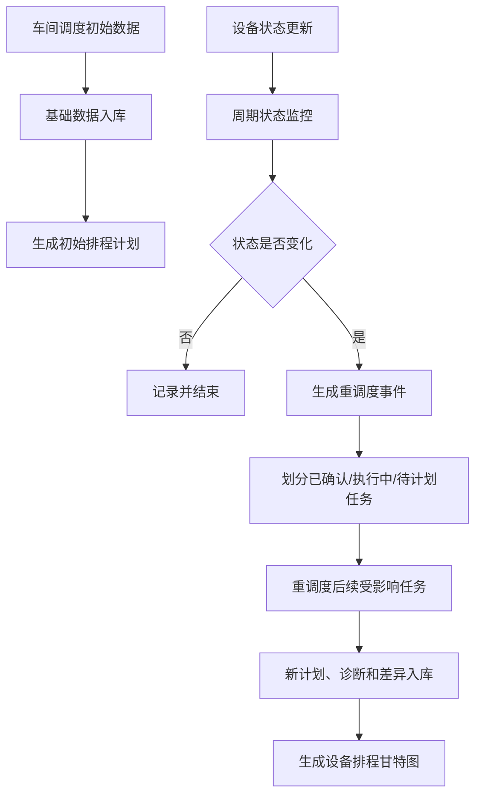
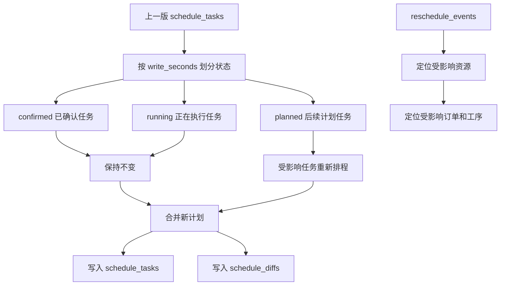
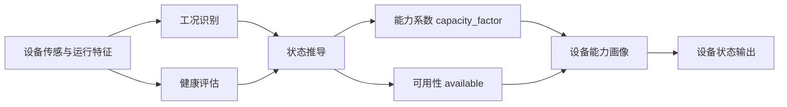
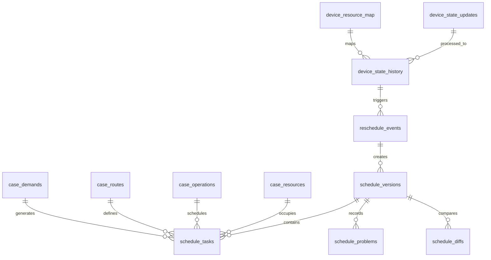
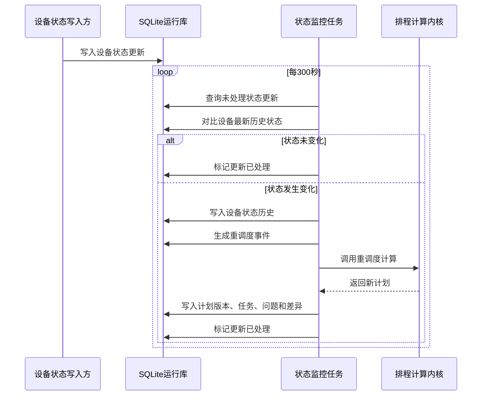

# 超真云·工业系统资源智能决策算法库 V1.0
# 说明书

## 1. 基本信息

| 项目 | 内容 |
| --- | --- |
| 软件名称 | 超真云·工业系统资源智能决策算法库 |
| 版本号 | V1.0 |
| 软件简称 | 超真云工业决策算法库 |
| 著作权人 | 【待填写】 |
| 开发完成日期 | 【待填写】 |
| 首次发表日期 | 【待填写；未发表则填“未发表”】 |
| 软件开发方式 | 【待填写】 |
| 软件分类 | 工业软件 / 智能决策算法软件 |
| 文档用途 | 软件著作权文档鉴别材料 |

## 2. 软件简介

超真云·工业系统资源智能决策算法库 V1.0 是一个本地运行的工业资源排程与设备状态联动算法库。当前代码位于 `chaozhenyun_decision_lib/`，采用 C++ 和 Python 实现。

软件当前已经实现以下内容：

1. 支持车间调度案例导入、基础数据入库与运行管理。
2. 支持 MRP 基准排程、GA 辅助优化排程以及设备感知排程。
3. 支持设备状态识别、健康评估、能力画像和可用性判断。
4. 支持设备状态变化检测、事件生成、任务冻结和重调度。
5. 支持排程结果、问题诊断、版本管理和差异比对入库。
6. 支持按固定周期扫描设备状态更新并自动触发重调度。
7. 支持从数据库结果生成静态 HTML 甘特图。

从功能构成上看，软件可以概括为三个层次：一是面向设备侧的状态感知与能力画像，二是面向生产侧的多任务协同调度，三是在设备状态变化后对生产计划进行重调度。

| 功能层次 | 软件中对应功能 | 说明 |
| --- | --- | --- |
| 多工况自适应的工业设备控制优化 | 设备状态与能力画像 | 识别设备状态、健康风险、可用性和能力系数，为排程提供设备能力输入 |
| 多任务协同的生产作业动态调度规划 | MRP 排程、GA 辅助优化和设备感知排程 | 基于订单、工序、物料、资源、路线和日历生成生产作业计划 |
| 多代理协作的工业系统行为智能决策 | 设备状态驱动的重调度 | 通过设备状态代理、调度规划代理和重调度代理之间的数据协同，完成状态变化后的计划调整 |

这三个层次共同形成“设备状态感知—生产作业调度—状态变化重调度”的闭环。设备状态进入排程计算，排程结果形成生产计划，设备状态变化后再触发后续任务调整，从而实现设备状态与生产计划之间的协同决策。

软件总体模块关系如下：


## 3. 软件目录结构

当前源码目录如下：

```text
chaozhenyun_decision_lib/
├── cpp/
│   ├── CMakeLists.txt
│   └── src/
│       ├── main.cpp
│       ├── ga.cpp
│       └── ga.h
├── device_state/
│   ├── analysis.py
│   ├── models.py
│   └── profiler.py
├── case_data/
│   ├── device_state_case/
│   └── job_schedule/
├── tools/
│   ├── run_local_workflow.sh
│   ├── table_reschedule_workflow.py
│   ├── schedule_monitor.py
│   ├── write_device_update.py
│   ├── inspect_runtime_tables.py
│   ├── build_table_gantt.py
└── tests/
    ├── test_analysis.py
    ├── test_device_state.py
    └── run_calendar_cpp.sh
```

## 4. 总体数据流

软件当前的数据流如下：

```text
车间调度初始数据
  -> 基础数据入库
  -> 生成初始排程计划
  -> 设备状态更新写入运行库
  -> 状态监控任务周期扫描
  -> 状态变化触发重调度
  -> 新计划、问题诊断和计划差异入库
  -> 根据数据库结果生成甘特图
```

设备状态画像模块数据流如下：

```text
设备运行特征
  -> 设备状态识别
  -> 健康评估与能力画像
  -> 设备状态、可用性、能力系数和可用时间窗口
  -> 通过 device_state_updates 表接入状态监控和重调度流程
```

其中车间调度主流程使用 SQLite 表作为运行主通道；设备状态画像模块提供状态识别和能力折算能力。

从功能协同角度看，软件可以理解为多个功能代理之间的协作：设备状态代理负责感知和画像，调度规划代理负责生成生产计划，重调度代理负责监听状态变化并调整后续任务。各功能代理通过数据库表交换数据，形成设备状态和生产计划之间的闭环协同。

主流程数据流图如下：



## 5. 生产作业动态调度规划设计

生产作业动态调度规划主要由 C++ 排程内核实现，入口文件为：

```text
cpp/src/main.cpp
```

构建配置文件为：

```text
cpp/CMakeLists.txt
```

编译后生成命令行程序：

```text
chaozhenyun_scheduler
```

### 5.1 输入数据读取

排程内核支持读取车间调度案例输入文件。表驱动流程中，这些文件由 SQLite 输入表临时导出到运行目录，属于内核适配文件，不作为对外中间结果保存。包括：

| 文件 | 代码用途 |
| --- | --- |
| `planning_dates.csv` | 读取计划起点和默认交期 |
| `demands.csv` | 读取订单编号、物料、数量、交期、优先级 |
| `resources.csv` | 读取资源及容量 |
| `operations.csv` | 读取工序、产出物料、单位工时、批量规则 |
| `operation_resources.csv` | 读取工序所需资源 |
| `operation_materials.csv` | 读取工序物料投入和产出 |
| `inventory.csv` | 读取期初库存 |
| `purchasable_items.csv` | 读取采购提前期和批量规则 |
| `routes.csv` | 读取产品工艺路线 |
| `operation_alternatives.csv` | 读取可选替代工序 |
| `resource_calendars.csv` | 读取资源日历 |
| `device_resource_map.csv` | 读取设备与排产资源映射 |
| `device_states.csv` | 读取设备状态和能力系数 |

### 5.2 MRP 排程实现

MRP 模式用于生成基准排程，重点解决物料齐套、工艺顺序、资源容量、班次日历和采购提前期等问题。

该功能会根据订单、路线、库存和资源信息，生成可执行的生产批次，并输出排程任务、采购建议和问题诊断。

`mrp_device` 模式在此基础上进一步考虑设备状态和能力系数，使基准计划能够更贴近真实资源能力。

### 5.3 GA+MRP 排程实现

GA 模式用于在可行排程空间内进一步优化任务顺序和资源选择，适合作为 MRP 的增强版求解方式。

该功能先搜索较优执行顺序，再交回 MRP 约束解码，因此仍会保留物料、工艺、日历、设备状态和冻结任务等约束。这样既能提升排程质量，又不会绕开基础业务规则。

### 5.4 设备状态联动排程实现

设备联动用于把设备可用性、能力系数和资源映射融入排程过程。

当设备不可用时，对应资源会被排除；当设备能力下降时，工序加工时间会按能力系数折算。这样排程结果能够体现设备状态变化对产线计划的影响。

对应运行模式：

```text
mrp_device
ga_device
reschedule_device
```

### 5.5 重调度实现

重调度用于处理设备状态变化、订单插单或资源不可用等场景。系统会冻结已完成和正在执行的任务，只对后续受影响任务重新排程，并输出新的计划版本与差异结果。

其中，`reschedule_device` 模式会同时读取最新设备状态，使设备不可用或能力变化影响重排结果。

说明：计算内核运行时会使用临时适配数据，计算完成后结果立即写回 SQLite。临时数据不作为软件对外结果保存，对外结果以计划版本、排程任务、问题诊断和计划差异等数据库表为准。

重调度内部处理关系如下：



## 6. 设备状态与能力画像设计

设备状态与能力画像模块位于：

```text
device_state/
```

### 6.1 特征分析实现

设备状态模块提供工况识别、健康评估和特征分析能力，支持从振动、转速、电流、温度、能耗等输入中提取设备状态信息。

模块可以计算时域特征、频域特征和轴承相关特征，并用于后续健康评分和故障模式判断。

### 6.2 能力画像实现

设备状态画像会把原始特征整理为可调度使用的状态输出，包括设备状态、可用性、能力系数和可用时间窗口。

这些结果既可以供设备健康分析使用，也可以直接写入状态更新表，参与后续排程联动。

设备状态画像结果可通过外部采集或调度集成程序写入 `device_state_updates` 表，由 `schedule_monitor.py` 统一进行状态变化检测和重调度触发。

设备状态画像模块处理链路如下：



## 7. 设备状态驱动的重调度设计

本章对应设备状态驱动的重调度主流程。软件不是单次排程后静态结束，而是围绕设备状态变化持续更新计划，实现设备状态和生产调度之间的联动。

核心工具包括：

```text
tools/table_reschedule_workflow.py
tools/schedule_monitor.py
tools/write_device_update.py
```

其中，`table_reschedule_workflow.py` 负责初始化运行表和执行一次排程；`schedule_monitor.py` 负责周期扫描设备状态更新表；`write_device_update.py` 用于模拟外部设备采集系统写入设备状态。

### 7.1 运行数据管理

软件使用 SQLite 保存运行数据，主要包括基础输入数据、设备状态数据、重调度事件和排程结果数据。

主要运行表关系如下：



基础输入表用于保存订单、资源、工序、路线、库存、采购规则和资源日历；设备状态表用于保存设备状态更新、设备状态历史和设备资源映射；排程结果表用于保存计划版本、任务明细、问题诊断和重调度差异。

### 7.2 初始案例数据入表

软件支持将车间调度案例的初始 CSV 数据导入数据库表。导入后，后续计算以数据库表作为主要数据来源。

当前支持导入的数据包括：

| 数据类型 | 说明 |
| --- | --- |
| 计划日期 | 计划起点和默认交期 |
| 订单需求 | 订单、物料、数量、交期和优先级 |
| 资源数据 | 设备、人员、工装等资源及容量 |
| 工序数据 | 工序、产出物料、工时和批量规则 |
| 工艺路线 | 产品到工序的顺序关系 |
| 物料关系 | 工序投入物料和产出物料 |
| 库存数据 | 期初库存和可用物料 |
| 采购规则 | 可采购物料、采购提前期和批量规则 |
| 设备映射 | 设备编号与排产资源编号的对应关系 |
| 初始设备状态 | 设备初始状态、可用性、能力系数和风险等级 |

### 7.3 设备状态更新入口

设备状态更新通过 `device_state_updates` 表进入系统。该表用于接收外部设备采集程序、设备状态画像模块或测试工具写入的设备最新状态。

主要字段包括：

```text
设备编号
设备状态
是否可用
能力系数
风险等级
状态写入时间
处理标记
```

该设计使设备状态和排产计算解耦：设备侧只负责写入状态，排程侧通过监控任务统一判断是否需要重调度。

### 7.4 周期状态监控

软件支持按固定周期扫描设备状态更新表，默认周期为 300 秒。监控任务只处理未处理的状态更新记录。

状态监控与重调度时序如下：



该机制避免了每次扫描都重复排程，只有设备状态、可用性、能力系数或风险等级发生变化时才触发重调度。

### 7.5 状态变化检测与事件生成

软件会将新写入的设备状态与上一条设备状态进行比较。比较内容包括：

```text
设备状态
是否可用
能力系数
风险等级
```

如果状态没有变化，系统只记录该次状态更新，不触发重调度；如果状态发生变化，系统会根据设备资源映射生成重调度事件。

当设备不可用时，系统生成设备不可用事件；当设备仍可用但能力下降或风险变化时，系统生成设备能力变化事件。

### 7.6 工单状态边界

重调度以设备状态写入时间作为当前计划边界。系统按该时间将上一版计划划分为三类：

```text
confirmed：写表时间之前已经完成或确认的任务
running：写表时间点正在执行的任务
planned：写表时间之后尚未执行的任务
```

其中 `confirmed` 和 `running` 任务保持不变，`planned` 且受设备事件影响的后续任务进入重排范围。

### 7.7 重调度

当设备状态变化生成重调度事件后，系统会基于上一版计划执行重调度。重调度过程如下：

1. 读取上一版计划任务，确定当前有效的计划版本。
2. 以设备状态写入时间作为重调度时点，划分已确认任务、正在执行任务和后续计划任务。
3. 保留已确认任务和正在执行任务，避免已经发生或正在执行的工单被重复调整。
4. 根据设备事件定位受影响资源，例如故障设备映射到的生产资源。
5. 找出使用该资源且尚未执行的相关订单、工序和任务。
6. 对受影响的后续任务重新计算资源占用和开始结束时间。
7. 将未受影响的任务与重新排程后的任务合并，形成新的计划版本。
8. 对比新旧计划，记录任务是否保持不变或发生变化。

重调度完成后，系统会把以下内容写入数据库：

| 入库内容 | 说明 |
| --- | --- |
| 计划版本 | 记录初始计划和重调度计划，保留版本编号、模式、事件编号和结果引用 |
| 排程任务 | 保存订单、工序、资源、数量、开始时间、结束时间和任务状态 |
| 问题诊断 | 保存缺料、交期风险、资源不可用等运行诊断信息 |
| 计划差异 | 保存重调度前后的开始时间、结束时间和变化状态 |
| 事件处理状态 | 标记设备状态变化事件已经被处理，避免重复触发同一事件 |

通过上述过程，系统既能保留已经确认的生产计划，又能对受设备状态影响的后续任务进行调整，并将重调度前后的结果统一保存在数据库中，便于后续查看、比对和生成甘特图。

### 7.8 数据库结果查看

运行完成后，可以通过数据库查看工具直接打开 `planning_runtime.sqlite`，查看基础数据、设备状态、重调度事件、计划版本、排程任务和计划差异。

该方式比单纯查看 CSV 文件更直观，也便于后续与真实业务系统数据库对接。

### 7.9 当前运行结果示例

当前车间调度案例入表后，基础数据规模如下：

```text
case_planning_dates          1
case_demands               166
case_resources              92
case_operations           3873
case_operation_resources  3707
case_operation_materials   166
case_inventory            1394
case_purchasable_items     166
case_routes               1228
case_operation_alternatives 2479
device_resource_map           2
```

设备 `FAN-01` 由 `degraded` 变为 `fault` 后，系统生成设备不可用事件，并形成两版计划：

```text
version 1: mrp_device_initial
version 2: mrp_reschedule_device
```

重调度后任务状态示例：

```text
confirmed 580
running     6
planned   642
```

计划差异示例：

```text
preserved 1171
changed     57
```

## 8. 甘特图生成设计

甘特图用于把数据库中的排程任务转换为可视化页面，帮助用户直观看到生产任务在不同资源上的时间安排。当前甘特图数据来自 SQLite 数据库中的排程结果表，并生成静态 HTML 文件供浏览器查看。

甘特图主要展示以下内容：

| 展示内容 | 说明 |
| --- | --- |
| 计划版本 | 显示当前查看的排程版本 |
| 时间轴 | 根据计划起点展示任务开始和结束时间 |
| 资源泳道 | 按设备、人员或工装资源展示任务占用情况 |
| 任务条 | 展示订单工序在资源上的执行时间段 |
| 任务状态 | 区分 planned、confirmed、running 等状态 |
| 任务详情 | 鼠标悬停时显示订单、工序、资源、数量和开始结束时间 |

通过甘特图可以重点查看：

1. 各资源在不同时间段的任务占用情况。
2. 任务之间的先后关系和并行关系。
3. 重调度后已确认任务、正在执行任务和后续计划任务的分布。
4. 设备状态变化后，受影响资源后续任务的调整情况。

任务状态通过不同颜色区分，页面图例中会直接标注色条含义：

| 颜色 | 状态 | 含义 |
| --- | --- | --- |
| 蓝色 | `planned` | 后续计划任务 |
| 灰色 | `confirmed` | 已确认或已完成任务 |
| 绿色 | `running` | 正在执行任务 |
| 橙色 | `material_shortage` | 存在缺料风险任务 |

甘特图由 `tools/build_table_gantt.py` 生成，输出文件为：

```text
case_data/job_schedule/table_gantt.html
```

该文件可直接用浏览器打开，页面数据来自数据库表，不需要用户手工选择 CSV 文件。

## 9. 当前案例数据

当前保留两个案例数据目录：

```text
case_data/device_state_case
case_data/job_schedule
```

`device_state_case` 用于设备状态模块案例，包含设备特征输入和设备状态输出。

`job_schedule` 用于车间调度案例，包含订单、工序、资源、路线、物料、库存、设备状态初始输入、运行数据库和设备排程甘特图。排程任务、问题诊断和差异结果保存在 `planning_runtime.sqlite` 中。

车间调度案例当前包含设备映射：

```csv
device_id,resource_id
FAN-01,M056
AC-01,M057
```

## 10. 测试设计

当前测试目录为：

```text
tests/
```

已实现测试：

- `test_analysis.py`：测试工况识别、健康评估、时域/频域特征和复杂故障模式识别。
- `test_device_state.py`：测试设备状态画像、能力系数、可用窗口和故障不可用判断。
- `run_calendar_cpp.sh`：测试 C++ 排程器的跨班日历和缺料诊断。

## 11. 运行环境

| 类别 | 内容 |
| --- | --- |
| 操作系统 | Linux 64 位 |
| C++ 标准 | C++20 |
| Python | Python 3 |
| 构建工具 | CMake |
| 本地表 | SQLite |
| 输入输出 | CSV、SQLite、HTML |

## 12. 对比实验与排程结果图

本节设置三个实验，用于展示软件在常规排程、辅助优化排程和设备状态变化重调度三类场景下的运行效果。三个实验使用同一套车间调度案例数据，计算结果写入本地 SQLite 数据库，并生成对应的设备排程甘特图，便于从任务数量、资源占用、完工时间和工单状态变化等角度进行对比。

### 12.1 实验一：MRP 基准排程

实验目的：验证软件能够根据订单、工序、物料、资源、路线和日历生成基础生产作业计划，形成后续优化和重调度的对比基准。

实验内容：

实验以车间调度案例基础数据为输入，采用 MRP 基准排程逻辑生成生产任务计划。软件会综合订单需求、物料供给、工艺路线、资源能力和日历约束，形成可落库、可查看的排程结果。

实验结果：

实验生成 1228 条计划任务，所有任务状态均为 `planned`，最大完工时间约为 `18 小时 28 分钟`。该结果说明 MRP 基准排程能够完整生成生产任务，并可作为后续优化排程的参照。

排程结果图可查看各设备、产线或操作组上的任务分布、任务先后关系和资源占用情况。

【此处插入图 1：MRP 基准排程结果图】

### 12.2 实验二：MRP+GA 辅助优化排程

实验目的：验证软件能够在 MRP 约束基础上，通过 GA 辅助优化任务顺序和资源选择，改善整体排程效果。

实验内容：

实验采用与实验一相同的输入数据，在保持物料、工艺、资源和日历等基础约束的前提下，引入 GA 辅助优化过程，对任务顺序和资源选择进行搜索与调整。

实验结果：

实验生成 1228 条计划任务，所有任务状态均为 `planned`，最大完工时间约为 `16 小时 38 分钟`。与 MRP 基准排程相比，MRP+GA 辅助优化后的最大完工时间由约 `18 小时 28 分钟` 缩短为约 `16 小时 38 分钟`，整体排程周期有所改善。

| 指标 | MRP 基准排程 | MRP+GA 辅助优化排程 | 对比结果 |
| --- | --- | --- | --- |
| 任务数量 | 1228 | 1228 | 任务规模一致 |
| 最大完工时间 | 约 18 小时 28 分钟 | 约 16 小时 38 分钟 | MRP+GA 更短 |
| 任务状态 | planned 1228 | planned 1228 | 均形成完整计划 |
| 甘特图 | `gantt_mrp.html` | `gantt_mrp_ga.html` | 可对比资源占用和任务排列 |

排程结果图可与实验一进行对比，重点查看任务排列是否更紧凑、资源空闲时间是否减少，以及最终完工时间是否提前。

【此处插入图 2：MRP+GA 辅助优化排程结果图】

### 12.3 实验三：设备状态异常触发重调度

实验目的：验证某一时段设备发生故障或不可用时，软件能够识别设备状态变化并触发重调度，同时保持已确认工单不变。

实验内容：

实验以 MRP 基准排程结果为初始计划，模拟设备 `FAN-01` 在计划开始后 `28800` 秒发生故障，并通过设备资源映射影响生产资源 `M056`。重调度时，系统保持已确认和正在执行的工单不变，对后续受影响任务重新安排。

实验结果：

实验生成 1228 条任务，其中 `confirmed` 任务 580 条，`running` 任务 6 条，后续 `planned` 任务 642 条，最大完工时间约为 `19 小时 40 分钟`。计划差异中，1171 条任务保持原计划，57 条任务发生调整。

结果说明：设备故障后，软件能够把设备状态变化传递到排程过程，避开受影响资源，并保留重调度发生前已经确认或正在执行的任务。排程结果图可重点查看故障资源后续任务的变化，以及灰色 confirmed 任务是否保持不动。

【此处插入图 3：设备状态异常触发重调度结果图】

### 12.4 设备排程甘特图文件

三个实验对应的甘特图文件如下：

| 实验 | 甘特图文件 | 主要查看内容 |
| --- | --- | --- |
| MRP 基准排程 | `gantt_mrp.html` | 基准计划下各资源任务分布 |
| MRP+GA 辅助优化排程 | `gantt_mrp_ga.html` | 优化后任务排列和完工时间变化 |
| 设备故障重调度 | `gantt_reschedule.html` | 故障设备影响、confirmed 工单保持和 planned 工单调整 |

甘特图色条含义：

| 颜色 | 状态 | 含义 |
| --- | --- | --- |
| 蓝色 | `planned` | 后续计划任务 |
| 灰色 | `confirmed` | 已确认或已完成任务 |
| 绿色 | `running` | 正在执行任务 |
| 橙色 | `material_shortage` | 存在缺料风险任务 |

## 13. 源程序鉴别材料建议

建议选取以下实际存在的代码作为源程序鉴别材料：

1. `cpp/src/main.cpp`
2. `cpp/src/ga.cpp`
3. `cpp/src/ga.h`
4. `device_state/analysis.py`
5. `device_state/profiler.py`
6. `device_state/models.py`
7. `tools/table_reschedule_workflow.py`
8. `tools/schedule_monitor.py`
9. `tools/write_device_update.py`
10. `tools/build_table_gantt.py`
11. `tools/run_local_workflow.sh`

上述文件均存在于当前 `chaozhenyun_decision_lib` 目录中，且与本文档描述的功能对应。
